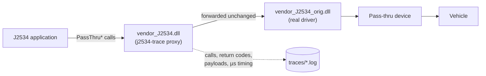

# j2534-trace

A transparent logging proxy for the SAE J2534 pass-thru API. It installs in
place of a vendor's J2534 driver DLL, forwards every call to the real driver
unchanged, and writes a timestamped trace of each call, its return code, and
the full message payload.

> ⚠️ **WARNING:** This software may permanently damage your vehicle.  
> See [DISCLAIMER.md](DISCLAIMER.md) for full terms before use.

**Status: paused.** The proxy, logger, and 20-check test harness are
complete and passing.

**Stack:** C++17 · Win32 API · MSVC · CMake · Python (ctypes) test harness

## The problem

J2534 is the standard Windows API that vehicle diagnostic and ECU
programming applications use to reach vehicle hardware. The application loads
a vendor-supplied driver DLL and calls its `PassThru*` functions. Both sides
are usually closed source, so there is no direct way to see what a session
actually sent, in what order, or with what timing.

j2534-trace sits at that DLL boundary. The application loads the proxy as if
it were the vendor driver, and the proxy loads the real driver and passes
every call through. Neither the application nor the interface needs to
change.



## How it works

- **DLL proxying by filename.** The proxy is deployed under the vendor
  driver's filename and exports the same 15 `PassThru*` functions
  (`__stdcall`, undecorated names via a `.def` file). It finds the real
  driver by taking its own module path and appending a configurable suffix
  (`_orig` by default).
- **Lazy, cached resolution.** Each export resolves its target through a
  mutex-guarded `GetProcAddress` cache, so the real driver isn't loaded until
  the first call ([proxy.cpp](proxy/proxy.cpp)).
- **Capture points chosen per direction.** TX payloads are logged before the
  call is forwarded, so they are on disk even if the driver hangs. RX
  payloads are logged only after a successful `ReadMsgs`, so a timeout never
  produces a phantom frame.
- **Config at load time.** `trace.ini` next to the DLL is read in `DllMain`.
  It controls logging on/off, the real-driver suffix, the flush interval, and
  the free-disk threshold.

## Sample trace

This excerpt comes from a test harness run against the mock driver, trimmed
for length:

```
[15:52:49.371 +021801us] PassThruOpen(name='') -> 0 deviceId=1
[15:52:49.371 +000033us] GetProcAddress failed for 'PassThruReadVoltage'
[15:52:49.371 +000106us] ReadVersion(device=1) -> 0 fw='1.0-MOCK' dll='1.0-MOCK' api='4.04'
[15:52:49.371 +000079us] PassThruConnect(device=1 proto=0x6 flags=0x0 baud=500000) -> 0 channel=1
MSG TX ch=1 proto=0x6 txflags=0x0 rxstatus=0x0 ts=0 len=2 edi=2 data=10 03
[15:52:49.372 +000424us] PassThruWriteMsgs(ch=1 timeout=1000) -> 0
[15:52:49.372 +000024us] PassThruReadMsgs(ch=1 timeout=1000) -> 0 num=1
MSG RX ch=1 proto=0x6 txflags=0x0 rxstatus=0x0 ts=1002 len=2 edi=2 data=50 03
...
[15:52:49.393 +004776us] Ioctl(handle=1 id=0x2) -> 0
[15:52:49.393 +000016us]   SET_CONFIG param=0x2 value=0x1
```

`10 03` is a UDS extended-session request, and the mock answers with the
positive response `50 03`. The mock deliberately omits `PassThruReadVoltage`,
so the proxy logs the missing export instead of crashing. `Ioctl`
SET_CONFIG/GET_CONFIG parameter lists are decoded inline. The full line
format is in [docs/USAGE.md](docs/USAGE.md#reading-a-trace).

## Design decisions

- **Fails open.** If logging can't start (low disk) or a write fails
  mid-session, logging shuts down for that process and the proxy keeps
  forwarding. A lost log is recoverable; a stalled call path during a
  flash session is not.
- **Low overhead.** By default every line is flushed, for maximum capture
  fidelity. In harness runs, a logged `Ioctl` round trip
  (Python → proxy → mock → log) takes a median of about 8 µs. Check 19 fails
  if logging overhead reaches 2 ms per call. `flush_ms` trades the risk of
  losing the unflushed tail for fewer disk syncs.
- **Thread safe.** A single mutex serializes the log writer, and filter hex
  dumps use per-thread buffers, so concurrent callers never produce torn
  lines or crossed filter data (checks 13 and 18). Export resolution is
  cached behind its own lock.
- **Timing-accurate traces.** Every line carries a microsecond delta from
  `QueryPerformanceCounter`. Every message also carries the device's own
  timestamp, for inter-frame timing analysis.
- **ABI mismatch detection.** A message whose `DataSize` exceeds the
  4128-byte buffer, or whose `ExtraDataIndex` exceeds `DataSize`, is flagged
  `[SUSPECT]`. This is a cheap signal that the application and driver
  disagree on struct layout.
- **Graceful failure.** A missing real driver or unresolved export returns
  `ERR_NOT_SUPPORTED` (`0xE2`) and is logged. The host application never
  crashes.
- **Nothing vendor-specific in the repo.** The version resource is generated
  from a template at build time. Values that some applications check are
  kept in a gitignored local file.
- **Clean builds.** The proxy builds with MSVC `/W4`. New warnings get fixed
  or consciously accepted, not suppressed.

## Testing

A Python `ctypes` harness loads the built proxy against a C++ mock vendor
driver and runs 20 numbered checks:

- API round trips and payload integrity, including a 3000-byte message
  checked byte for byte
- timeouts, error-code propagation, a missing export, and a missing driver
- `Ioctl` decoding
- multithreaded stress
- disabled mode, the low-disk fail-open path, and a latency budget

Load-time behavior is exercised in fresh subprocesses, because configuration
is read in `DllMain`.

The harness validates proxy plumbing. It can't validate the ABI against a
real vendor driver; only a live session can confirm that.

Full check list and harness design: [docs/TESTING.md](docs/TESTING.md).

## Quick start

Requires Visual Studio Build Tools (C++), CMake 3.24+, and **32-bit**
Python. The DLLs are Win32/x86 to match the host applications.

```
cmake -B build -G "Visual Studio 18 2026" -A Win32
cmake --build build --config Release
py -3.12 test/harness.py
```

| Doc | Covers |
|-----|--------|
| [docs/BUILDING.md](docs/BUILDING.md) | Toolchain, generators, verifying the x86 build, version resource |
| [docs/USAGE.md](docs/USAGE.md) | Deploying next to a real driver, `trace.ini` reference, trace format, reverting |
| [docs/TESTING.md](docs/TESTING.md) | Harness design, all 20 checks, limitations |

## Repository layout

```
proxy/
  proxy.cpp          15 PassThru* exports: resolve, forward, log
  logger.cpp/.h      serialized trace writer, flush policy, low-disk guard
  j2534_types.h      PASSTHRU_MSG / SCONFIG layouts
  exports.def        undecorated export names
  resource.rc.in     version-resource template
test/
  harness.py         20-check end-to-end harness
  mock_driver/       mock vendor driver: UDS echo, config store, periodic msgs
docs/                build, usage, and testing reference
```

## License

Apache-2.0. See [LICENSE](LICENSE) and [NOTICE](NOTICE). Read
[DISCLAIMER.md](DISCLAIMER.md) before use; contribution terms are in
[CONTRIBUTING.md](CONTRIBUTING.md).
